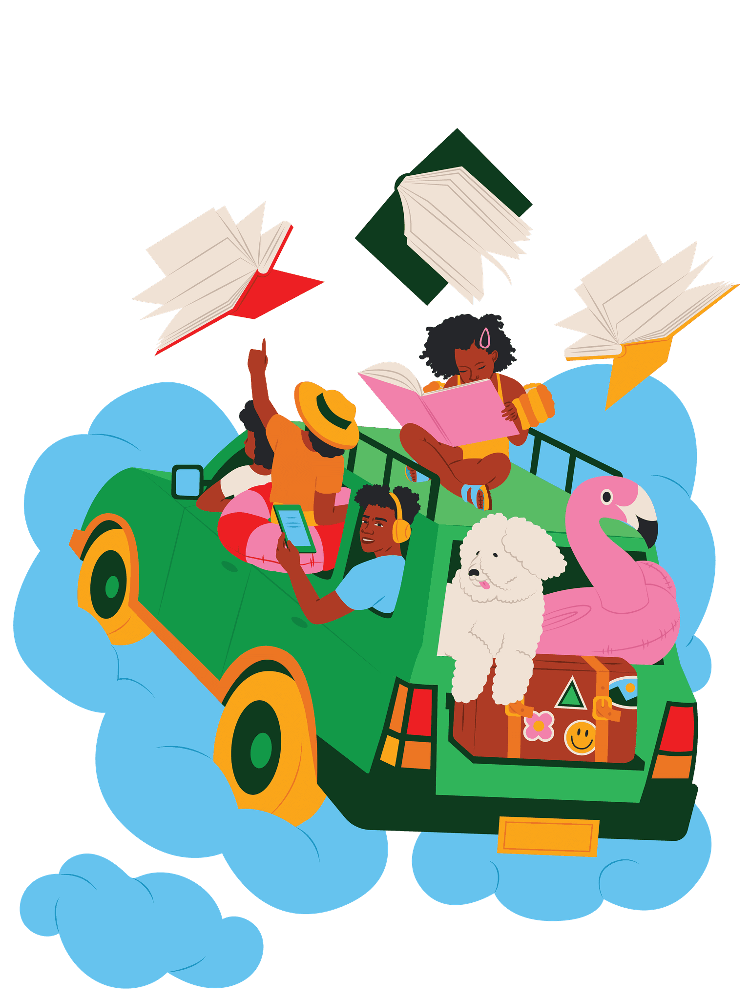
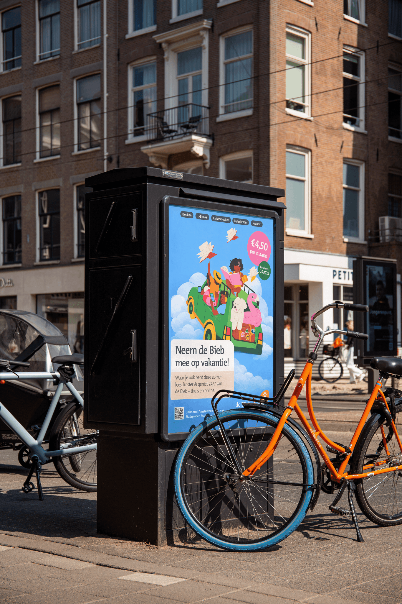

## Bibliotheek Amstelland — illustration for summer reading

**Client**\
Bibliotheek Amstelland

**Project**\
Illustration for summer reading campaign (print and digital)

**About the project**\
For Bibliotheek Amstelland, I created an illustration for a summer reading campaign. The image shows a family on their way to vacation, driving through the clouds — fully in holiday mode.

Within that scene, reading is part of the journey: books are present in both physical and digital form, reflecting that reading can happen anywhere, and in more than one way.

**Approach**\
The illustration needed to communicate a feeling first: freedom, anticipation, and the ease of summer. Rather than focusing on instructions or messaging, the image invites people into a moment.

I combined a playful, light atmosphere with clear visual cues that reference both printed books and online reading. By placing reading naturally within a holiday scene, the illustration suggests that stories travel with you, whether in a bag or on a screen.

The floating, cloud-based setting adds a sense of imagination and escape, aligning reading with daydreaming and discovery.

**Result**\
The illustration supports the campaign by connecting reading to a positive, recognisable summer feeling. It helps position the library as something that travels with you, before, during, and beyond the holiday.

 

