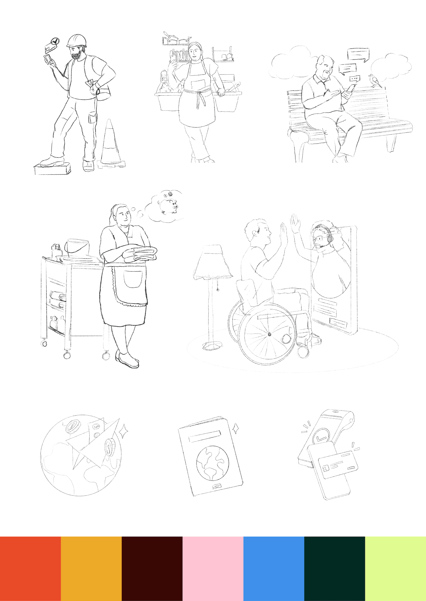
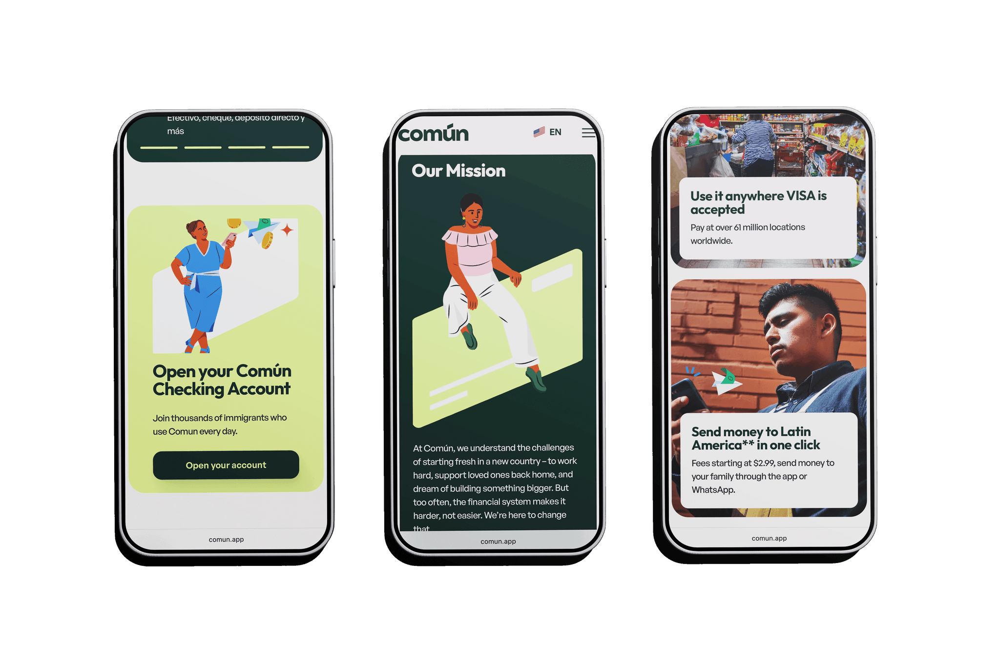

#### Común — illustration for a community-focused banking app

**Client**\
Común mobile banking app

**Project**\
Illustration for app, web, and social

**About the project**\
Común is a banking app for Hispanic immigrants in the U.S. It helps people open accounts, manage daily finances, and send money home, without the usual barriers or confusion.

I worked closely with Lunour on the visual language, translating the brand into a flexible illustration system. The goal was to make financial tools feel clear, welcoming, and human.

**Approach**\
Banking visuals are often abstract or distant. For Común, that wouldn’t make sense. This app is built around community and real lives, so the visuals needed to reflect that.

I focused on everyday moments and a wide range of people, drawn in a warm, optimistic style. Color and simplicity play a big role, not to decorate, but to reduce friction and help users feel at ease while using the app.

**Result**\
The illustrations add personality and clarity across the app and online touchpoints. They help turn a complex system into something that feels understandable and trustworthy, while making sure users can actually see themselves represented.\
In this project, the focus wasn’t on adding style, but on creating a visual language that feels open, recognizable, and supportive, especially for people navigating a new financial system.

**Early sketches focused on everyday situations and recognisable gestures:**

 

