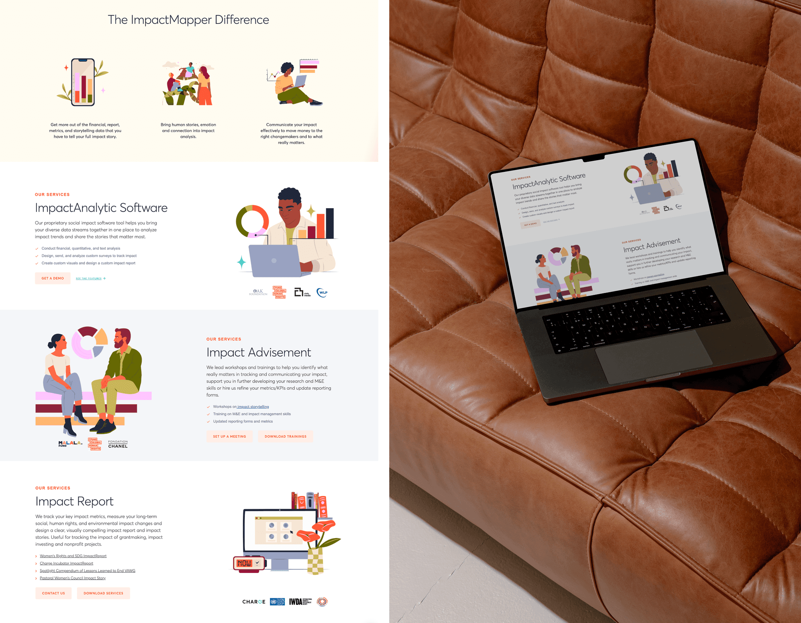
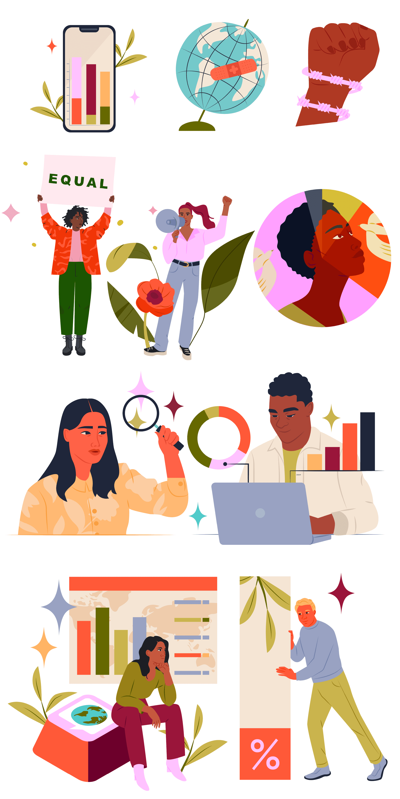
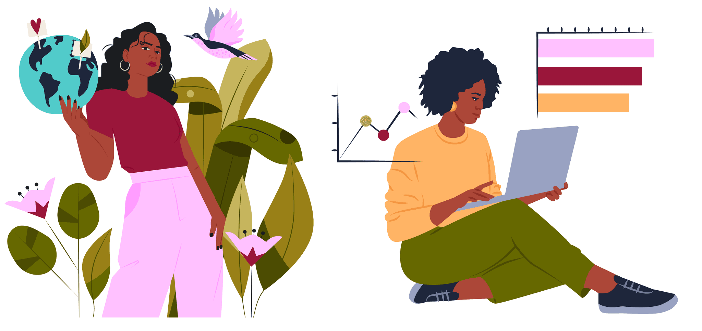

**Client**\
ImpactMapper

**Project**\
Illustration for reports and digital impact materials

**About the project**\
ImpactMapper builds tools that help organisations understand, measure, and share their social and environmental impact. Their platform and reporting tools are used by donors, philanthropists, investors, businesses and nonprofits working on issues like climate action, human rights, and sustainable development.

For this project, I created a set of illustrations used in ImpactMapper’s impact report and supporting digital materials. The aim was to help complex information land more clearly and intuitively — without making it feel simplistic.

**Approach**\
The audience for this work is diverse: impact teams, funders, nonprofit leaders, analysts and decision-makers who engage with reports, visual data and strategic insight every day. The illustrations needed to support understanding *and* help communicate meaning across different sectors and contexts.

Climate and impact data can easily feel abstract or dense. My goal was to find a visual language that helps people *see* relationships and trends, instead of just reading about them. I focused on simple, expressive forms and clear compositions that support information hierarchy, so visuals work alongside text and data, not in place of them.

**Result**\
The illustrations help complex content feel more approachable and navigable. They support connection between ideas and make it easier for diverse audiences to engage with key insights and stories of impact.

Illustration doesn’t make complexity disappear, but it can make it feel navigable. Here, visuals act as signposts: helping people move through information with clarity and confidence.

