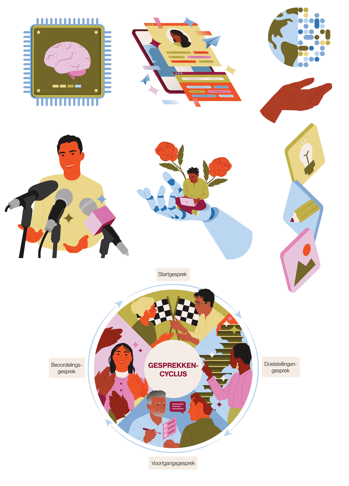
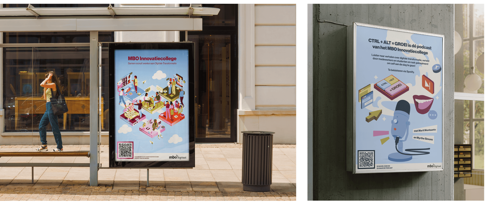
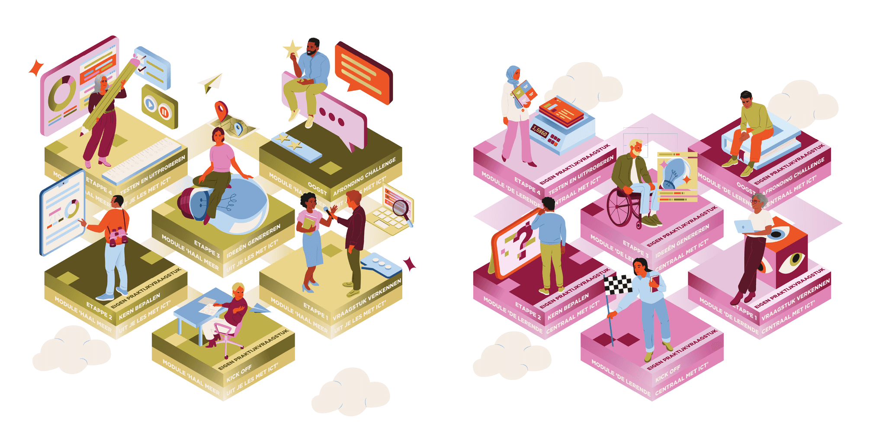
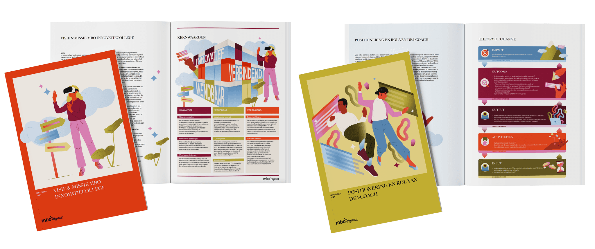
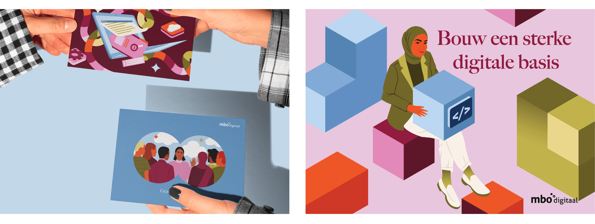
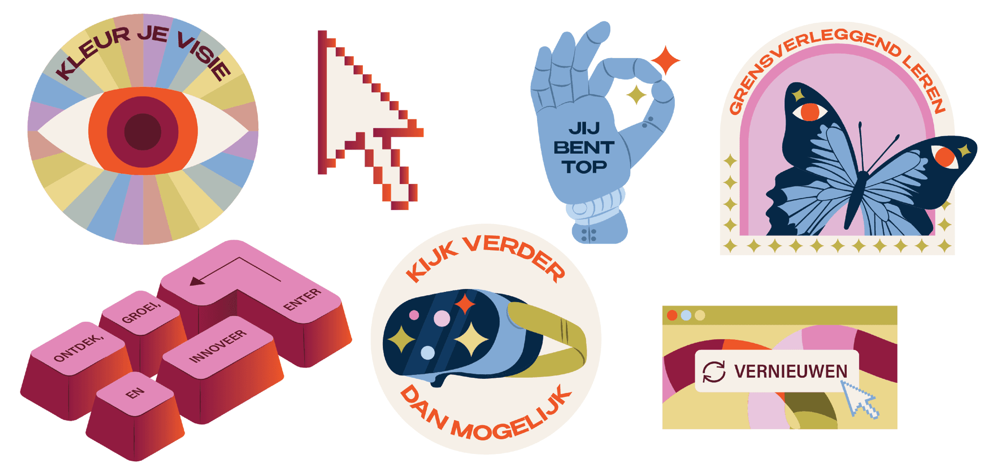
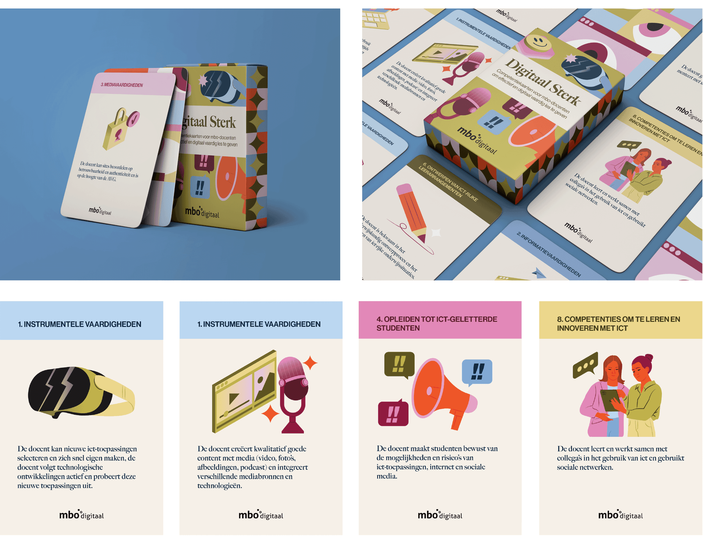

**Client**\
MBO Digitaal

**Project**\
Illustration and visual design for educational tools, events, and communication

**About the project**\
MBO Digitaal supports vocational education in the Netherlands by developing tools, knowledge, and programs around digital literacy, innovation, and professional development.

Over the course of multiple projects, I worked with MBO Digitaal on a range of visual materials — from illustrations and covers to printed tools and event communication. Rather than standalone visuals, the focus was on creating a consistent and recognizable visual language that could grow with their work.

**Approach**\
MBO Digitaal operates in a complex field, connecting educators, schools, and policymakers. The visuals needed to support that complexity without becoming abstract or distant.

I focused on clarity, structure, and recognizability. Illustrations were used to explain ideas, support conversation, and make educational content easier to engage with. The style stays accessible, with enough warmth to feel inviting, but clear enough to function within practical tools.

Across different formats, from printed materials to conference visuals, consistency played a key role. Each element needed to work on its own, while still feeling part of a larger whole.

**Result**\
The visual language helps MBO Digitaal communicate complex topics in a clear and approachable way. The illustrations support understanding, spark conversation, and bring cohesion across different tools and moments — from day-to-day use to large-scale events.

**The card game**\
One of the central outcomes of this collaboration was the development of a physical card game designed to support conversation and reflection within vocational education. The cards are used in workshops and team sessions, helping educators discuss themes like digital skills, professional development, and collaboration.

My role was to design both the visual system and the illustrations for the cards. Each card needed to be clear, recognisable, and easy to use in group settings. The illustrations support the content by making abstract themes more concrete and by inviting discussion, rather than steering it.

Because the game is a practical tool, usability played a big role in the design. The visuals needed to work at a glance, hold up in repeated use, and remain flexible across different contexts and groups.
