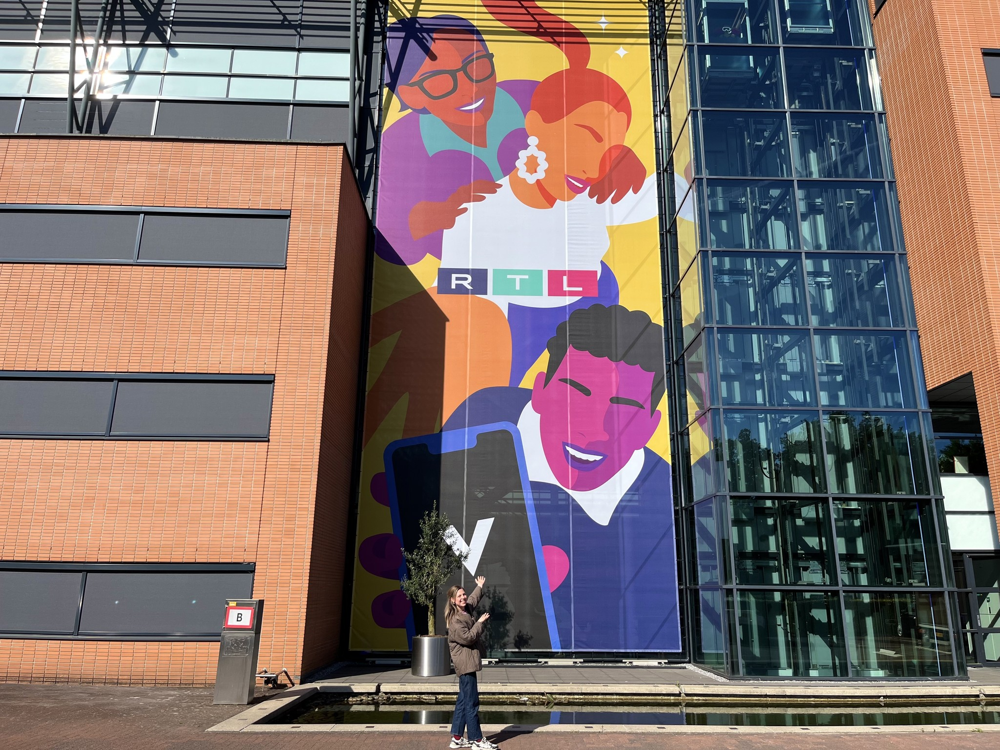

**Client**\
RTL

**Project**\
Illustration for large-format print (facade banner)

**About the project**\
For RTL, I created a single illustration designed as a large-scale facade banner. The artwork was used as a visual statement in a public space, where it needed to communicate clearly and confidently from a distance.

Rather than functioning as part of a broader system, the illustration stands on its own as a bold, recognisable image tied to RTL’s brand.

**Approach**\
Designing for large formats comes with specific challenges. The illustration needed to be readable at scale, work in an architectural context, and remain visually strong without relying on small details.

I focused on clear shapes, strong composition, and a limited but expressive visual language. Every element was considered in relation to distance, viewing angles, and movement, making sure the image holds up whether seen up close or from across the street.

**Result**\
The final illustration translates RTL’s brand into a striking, public-facing visual. Scaled up as a facade banner, it functions as a clear and confident presence in the urban environment.

