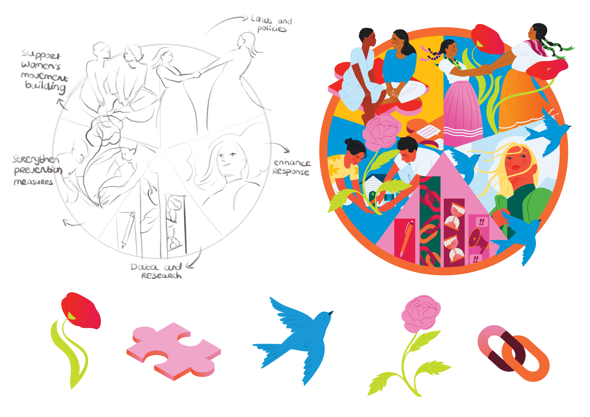
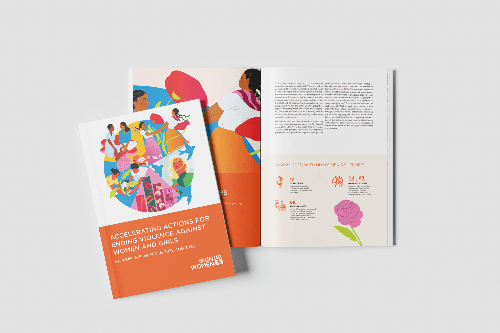
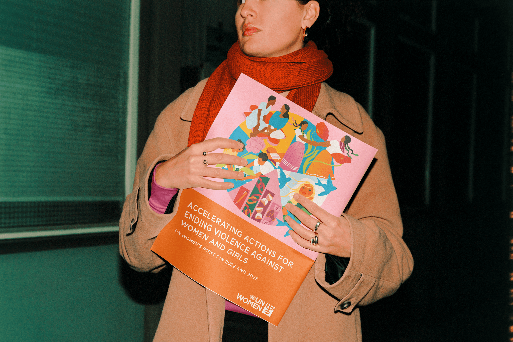

#### UN Women — illustration for a global gender equality organization

**Client**\
UN Women

**Project**\
Illustration for reports and digital communication

**About the project**\
UN Women is the United Nations entity dedicated to gender equality and the empowerment of women and girls worldwide. Their work focuses on research, policy, and advocacy around issues such as safety, rights, and representation.

I created a series of illustrations to support their communication on gender-based violence. The visuals were used to clarify complex content and help guide readers through policy-driven material.

**Approach**\
The subject matter called for a careful balance. The illustrations needed to feel clear and supportive, without becoming heavy or abstract. Their role was to add structure and focus, while respecting the seriousness of the topic.

A central illustration brings five impact areas together in a single wheel. The visual highlights how these areas are interconnected, showing how each one contributes to the shared goal of ending violence against women and girls. By presenting them as one unified system rather than separate themes, the illustration reinforces the idea of collective impact.

Throughout the project, I focused on calm compositions, clear symbolism, and human figures that feel grounded and relatable. The visual language stays direct and readable, helping readers engage with the content without distraction.

**Result**\
The illustrations add clarity and coherence to UN Women’s communication. They help make complex information more accessible, while maintaining the integrity and weight of the subject matter.

 

 

